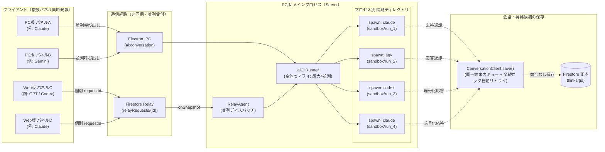

# AIChat 並列処理化の設計・実装概要

複数のAIChatパネル（`Thinktank` / `Seeds` / `Discuss`の各ペイン / `Harvest`）および、**PC版自身のAIChat**と**Web版からPC連携中継されたAIChat**が（それぞれ異なるAIモデルであっても）同時に発報された際、待ち時間なく並列に処理し、混線や保存エラーを起こさず確実に応答・記録するための設計・実装概要です。

---

## 1. 全体アーキテクチャとデータの流れ

---

## 2. 変更対象ファイルと実装内容（3つの柱）

### ① 中継エージェント（`RelayAgent`）の並列ディスパッチ化
* **対象ファイル**: `electron/relayAgent.cjs`
* **変更前の課題**:
  `_queueFirestoreSnapshot` にて `this._requestQueue = this._requestQueue.then(...)` で1本の直列Promiseチェーンに繋いでいたため、Web版から複数リクエストが来ると1件ずつ順番待ちになっていた。
* **変更内容**:
  * 直列チェーンを廃止し、`snapshot.docChanges()` で検知した `added` ドキュメントごとに非同期で `_claimAndProcessFirestoreRequest` を並列起動する。
  * 実行中の全リクエストのPromiseを `Set`（`this._activeRequests`）で追跡し、PC連携OFF時やリスナー破棄時（`_stopFirestoreListener`）には `Promise.allSettled` で全アクティブ処理の完了を待ってからクリーンアップする。
  * 同一スナップショット更新イベント等で同じ `requestId` が重複してディスパッチされないよう、処理中 `requestId` の重複排除セット（`this._inFlightRequestIds`）を設ける。

---

### ② AI CLI 実行エンジン（`aiCliRunner`）のプロセス隔離と全体並列制御
* **対象ファイル**: `electron/aiCliRunner.cjs`
* **変更前の課題**:
  1. すべてのCLI実行が単一の固定フォルダ `os.tmpdir()/thinktank-ai-cli-sandbox` を作業ディレクトリ（`cwd`）として共有しており、複数プロセス同時起動時に干渉するリスクがあった。
  2. PC版自身のIPC経由とWeb版中継経由が同時に走った際、プロセス起動数を制御する仕組みがなかった。
* **変更内容**:
  * **実行ごとの独立サンドボックス**:
    実行ごとに一時サブディレクトリ（`os.tmpdir()/thinktank-ai-cli-sandbox/run_<timestamp>_<random>`）を作成して `cwd` に指定し、プロセス終了時に自動削除する。これにより、異なるモデル（`claude` / `codex` / `agy`）や同一モデルが何個同時に走っても完全に隔離される。
  * **PC全体の同時実行セマフォ（上限管理）**:
    PC版（IPC）とWeb版（Relay）の合計で同時に起動するAI CLIプロセス数を制限するセマフォ（既定値：最大 `4` 並列）を `aiCliRunner.cjs` に導入する。通常利用（複数パネル同時発報）は待ち時間ゼロで即時並列実行しつつ、異常な大量リクエスト時のみリソース枯渇を防止する。

---

### ③ 会話履歴・昇格候補の保存時（`ConversationService`）の競合防止
* **対象ファイル**: `src/services/ConversationService.ts`
* **変更前の課題**:
  複数のパネル（またはPC版とWeb版）が同じBundleを参照して同時にAIへ質問し、ほぼ同じタイミングで応答が返ってきた場合、`ConversationClient.save()` が同じBundleやChatレコードを更新しようとして Firestore の楽観ロック（`baseUpdatedAt`）競合エラーになる可能性があった。
* **変更内容**:
  * **同一アプリ内の保存キュー（ミューテックス）**:
    AIの推論（`generate`）自体は完全に並列で走らせた上で、回答完了後のレコード保存処理（`save`）だけをアプリ内の軽量キューで直列化する。これにより、同一画面内の複数パネルが同時に回答を受け取っても、順番に最新状態を読み取って追記するため競合しない。
  * **別端末（PC版 ⇔ Web版）間の楽観ロック競合時の自動リトライ**:
    PC版とWeb版がまったく同じ瞬間に同じレコードを保存して楽観ロック競合エラーが発生した場合、エラー画面（「回答を保存できませんでした」）をすぐに出すのではなく、最新レコードを自動で再取得して会話ターン・昇格候補をマージし直す**自動リトライ（最大3回）**を行う。

---

## 3. 検証・テスト

1. **`electron/relayAgent.test.ts`**
   * 複数の `queued` リクエストが同時に到着した際、1件目の完了を待たずに2件目以降も並列で `running` に遷移・実行されることを検証。
2. **`electron/aiCliRunner.test.ts`**
   * 複数モデルの同時呼び出し時に、独立したサンドボックスディレクトリで並列実行され、完了後にクリーンアップされること、および同時実行数上限セマフォが機能することを検証。
3. **`src/services/ConversationService.ts` 関連テスト**
   * 複数パネルから同時に `save()` が呼ばれた際（および楽観ロック競合発生時）に、両方の会話ターンと昇格候補が失われずにマージ保存されることを検証。
